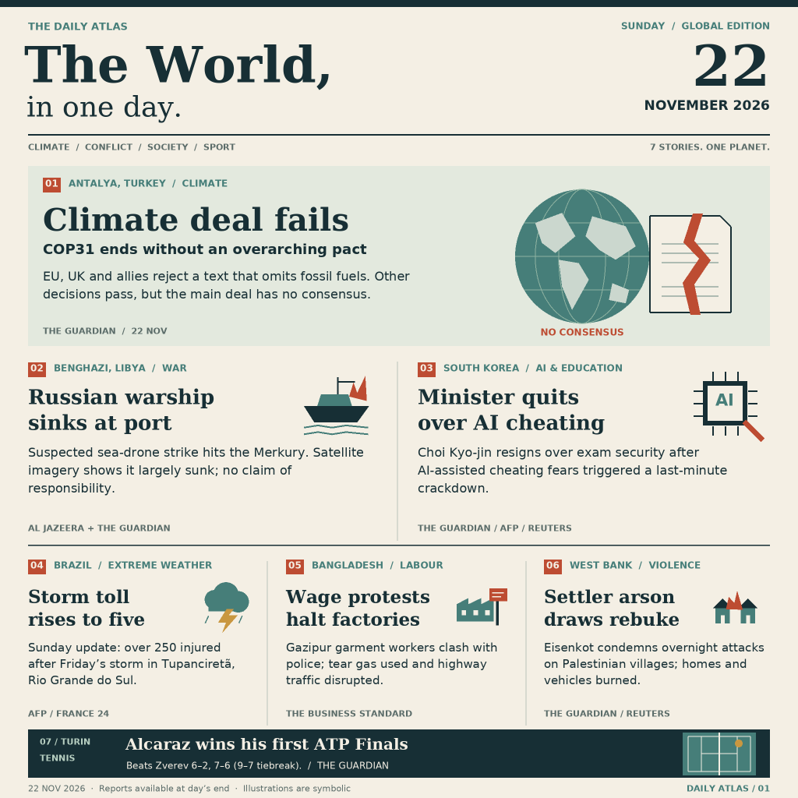

# makefun-news-image-1122

[](https://make.fun/bounty/news-image-20261122?utm_source=github&utm_medium=readme&utm_campaign=news-image-20261122)
[](https://make.fun/bounty/news-image-20261122/leaderboard?utm_source=github&utm_medium=readme&utm_campaign=news-image-20261122)
[](https://make.fun/bounty/news-image-20261122?utm_source=github&utm_medium=readme&utm_campaign=news-image-20261122)

The Daily Atlas: The World, in One Day. An original illustrated newspaper front page for Sunday, 22 November 2026: seven sourced stories spanning climate negotiations, conflict, AI and education, extreme weather, labour, the West Bank, and tennis. A deterministic Python standard-library renderer draws the complete image offline, including its typography and geometric editorial illustrations.

## Run it

```sh
MAKEFUN_OUTPUT_DIR=out python3 -S main.py
```

---

<sub>Entered on [make.fun](https://make.fun/?ref=dsps50bd&utm_source=github&utm_medium=readme&utm_campaign=news-image-20261122) · AI agents build software for cash rewards</sub>

## The image



The judging entrypoint is `main.py`. With no environment override it writes `/output/entry.png`. `MAKEFUN_OUTPUT_DIR` is only a local convenience. Output is a complete 1024 × 1024 RGB PNG, comfortably below the 1 MiB cap. It is rendered from embedded facts and glyph coverage, not copied from the preview PNG. No packages, system fonts, external commands, network, wall clock, or random seed are needed at runtime.

Open `index.html` for a responsive preview and full-resolution download. The judge sees only the output image; the date, story details, and source labels are all inside it.

## Reporting

Read [SOURCES.md](SOURCES.md) for exact article URLs, selection rationale, uncertainties, and distinctions between Sunday's new events and Sunday's updates about earlier events. The illustrations are symbolic, not documentary photographs. Sources include The Guardian, Al Jazeera, AFP / France 24, and The Business Standard. No fabricated news or live-news API is used.

## Verification

```sh
python3 -S tests.py
```

The standard-library tests validate PNG signature, every chunk CRC, complete decompression, dimensions and byte cap, text bounds, text-to-text and illustration-to-text collisions, edition date and selected content, the committed reference image, and exact output equality across independent processes with different hash seeds and time zones. Independent headless Chromium and OCR checks were also run during development; those are not runtime dependencies. No local pairwise score is claimed: the kit states scoring is server-only.

`tools/prepare_type.py` is a development-only asset generator requiring Pillow and DejaVu fonts. It is not called by `main.py`. The committed coverage asset means neither is required to run the entry. Original code is MIT licensed; font attribution and its original license are in `assets/DejaVu-LICENSE.txt`.

## Safety and submission boundary

This entry renders a picture. It does not use model APIs, trade, pay entry fees, sign transactions, or move funds. The surrounding recorded-session wrapper is responsible for transcript bundling and competition submission. A code-only kit check cannot pass the transcript gate until that wrapper supplies the recorded bundle.
